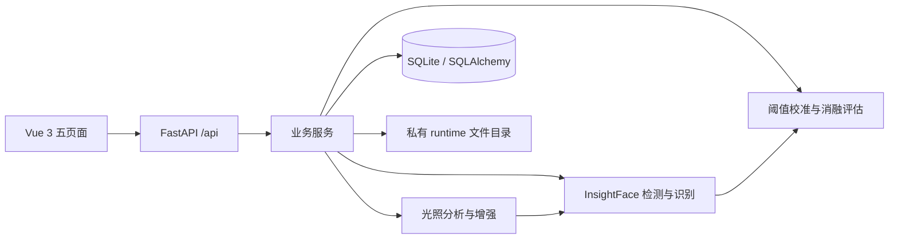

# 系统架构与技术选型

## 目标与分层

本系统为单机教学研究平台，前后端分离。浏览器只负责上传、参数选择、预览与结果查看；所有图像处理、人脸模型和指标计算在 Python 后端执行。

`api/routes.py` 负责路由、输入绑定、响应封装；`services` 负责注册事务、图库快照、ZIP 导入、后台实验；`algorithms` 是无 HTTP 依赖的算法模块；`schemas` 用 Pydantic 校验范围、类型、枚举和有限值；`models` 是 ORM 实体。

统一成功响应 `{data, message}`，失败响应 `{data:null, message}`。模型不可用为 503，业务校验失败为 400/422，数据冲突为 409。Swagger 自动描述端点。`Response.data` 允许不同业务结果，完整字段语义在接口文档中说明。

## 前端

Vue Router 动态路由分包；Axios 封装 API 错误与超时；Element Plus 仅加载实际使用的表单、表格、加载和提示组件。共享图片组件负责预览与单图下载；网页不提供模型状态或手动加载入口，实验对比集中在实验评估页面。

UI 使用深灰蓝侧栏、浅灰工作台和蓝色强调，手机折叠菜单。Pinia 未引入：页面间无复杂全局状态，不增加无用途依赖。

## 模型与运行时

后端启动时在线程池自动加载本地模型，完成后才开始接收请求；加载失败记入日志并保留图像增强功能，人脸请求会重试并返回具体错误。加载使用同一线程锁和实例，重复请求不会重复加载。

显式创建两个 ONNX Runtime 会话，使用 InsightFace 0.7.3 对应的检测/特征封装，固定 `buffalo_l` 包的 SCRFD 检测器和 ResNet50 ArcFace 特征模型。检测输入 640×640，检测阈值 0.5；特征网络使用五点对齐的 112×112 图像。

默认 ONNX Runtime CPU；GPU 安装见部署说明。有 CUDA provider 时优先尝试 CUDA，ORT 实际 session providers 写入配置，不将检测到 GPU 包误报为实测 GPU 加速。此环境只验证 CPU。推理由 RLock 串行保护；每个 ORT 会话 intra=2、inter=1，OpenCV 2 线程。直接构造会话绕过该版本 get_model 丢弃 sess_options 的问题，并避免加载三个人脸属性/额外关键点模型。实际线程配置可从模型状态查询。

PyTorch 模型训练不属于本实训的必要路径。保留可选依赖文件和硬件诊断脚本，推理使用官方 ONNX 权重，避免重复加载另一套深度学习模型。

## 数据表

| 表 | 用途 | 关联与删除 |
|---|---|---|
| Person | 姓名、备注、注册时间 | 一对多 FaceSample |
| FaceSample | 原始图片路径、像素摘要、采集会话、特征、质量、模型指纹 | 人员删除级联删除样本，服务层删除文件 |
| RecognitionRecord | 验证/检索决策、阈值、耗时 | 人员引用 SET NULL；删除服务清理关联查询记录 |
| PendingSampleDeletion | 等待清理的 UUID 注册照片路径 | 与身份删除一起提交；文件清理成功后移除，失败保留重试 |
| DetectionTask | 单次检测计数、增强方法 | 保存实际检测记录 |
| Dataset | 数据来源、许可、划分、清单、场景和标注 | 图片保存在私有随机目录 |
| Experiment | 参数、环境、快照摘要、进度、状态、汇总 | 关联 Dataset，后台任务逐项更新 |
| ExperimentResult | 方法、场景、样本索引、真实预测、计数 | 实验删除级联 |
| Calibration | 校准实验、各方法阈值、FAR、样本数 | 测试实验引用后需先删除测试结果 |

SQLite 启用外键、WAL 和 30 秒 busy timeout；注册先检查所有照片，最后统一落库，失败回滚并清理已写文件。

## 耗时任务

实验使用 FastAPI BackgroundTasks 配合单个实验锁，排队逐个执行，进度持久化。前端每 2.5 秒查询活动任务；每幅图的各方法以一致模型、模板、阈值执行，原始标签只在得到预测后计算指标。进程重启后残留 queued/running 任务标记 failed，禁止将半成品当完整实验。适用于单用户、单 Uvicorn worker；不支持多进程并发任务调度。

模型预热不计入平均耗时；实验计时覆盖增强、检测、特征提取与相似度检索，不包括磁盘读取、JSON/图片编码、标注比对。按需检测页的首轮推理可能有冷启动效应，时延不能与实验预热时延直接等同。

## 文件边界

默认 runtime 目录 0700，数据库、照片 0600；文件名由服务生成，不接受用户提供的绝对路径。ZIP 不解压用户路径，拒绝目录穿越、重复条目、超量解压。图片先用 Pillow 检查真实格式、像素上限和 EXIF，再转 OpenCV BGR。只接受 JPEG/PNG，每张 ≤12 MB、≤1600 万像素；数据包 ≤100 MB，解压声明总量 ≤256 MB。

本地 Origin 和 Host 白名单，禁止公开 runtime 静态目录，接口响应 no-store。它不是具备账号、权限隔离和审计的生产系统。需要多人部署时应先补充认证、授权与 TLS。

已知身份标注同时绑定注册时间，避免旧数据库复用数字编号后误指向另一人；新建 Person 表启用 SQLite AUTOINCREMENT。旧清单没有注册绑定时须核实并重新导入，不默认接受为可信标签。该检查不修改用户原有注册内容。

## 增强识别与多脸评估

自动参数任务使用原图和增强图检测、同位置五点对齐与 0.7/0.3 特征融合。每张脸各自进行阈值决策；增强额外检测保留且按 IoU 去重。注册仍要求单脸。图片级多脸评估只在得到全部独立预测后按精确 person_id 判断任一命中；不会将标签传给融合或身份匹配。新实验冻结算法版本、识别策略、融合权重与计分协议，旧记录不重算。多脸识别记录保存逐脸判定，删除身份也清理这些逐脸判定及其候选涉及的记录。

`face_encodings` 保存兼容模型升级后的派生人脸特征，以 sample_id 和 model_fingerprint 为联合主键，随 FaceSample 删除级联清理。原始照片、FaceSample 特征和历史实验保持不变；启动阶段预先建立新版图库。
